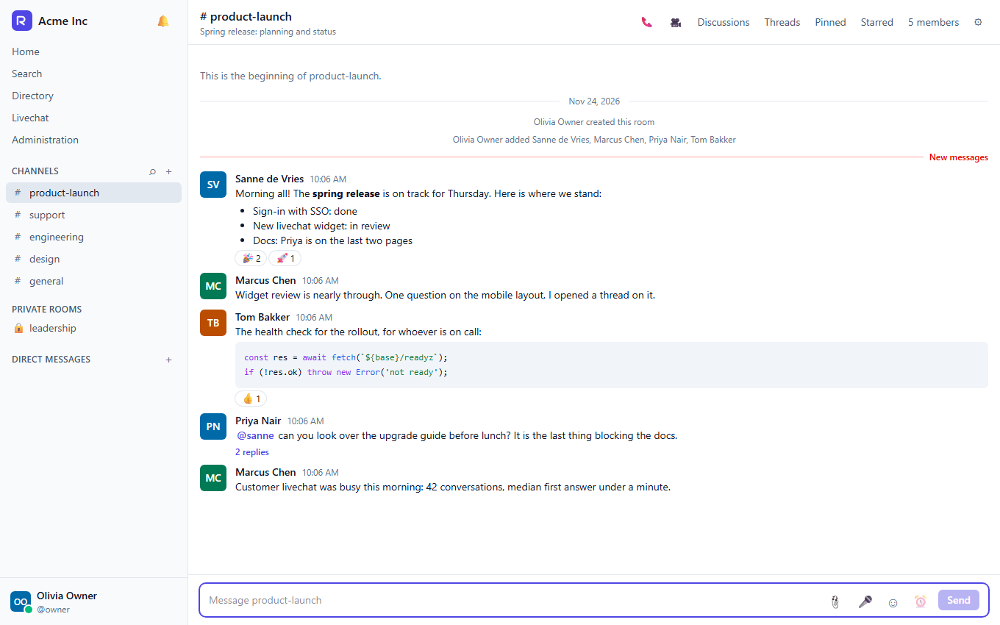
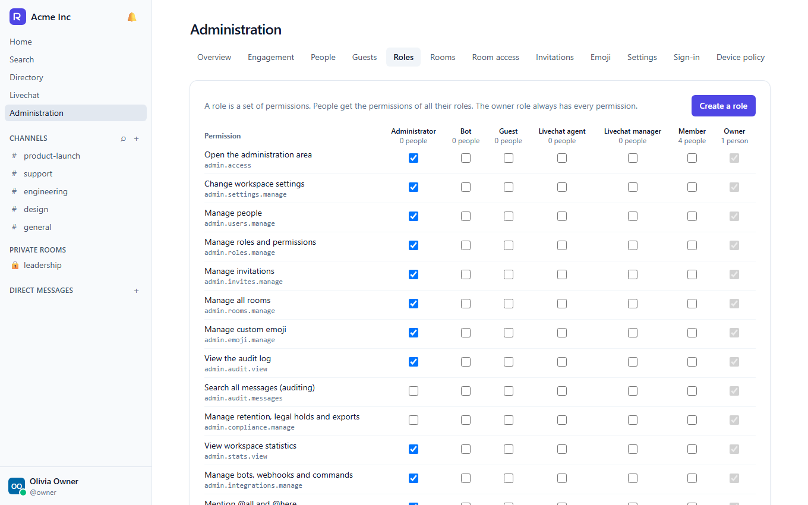
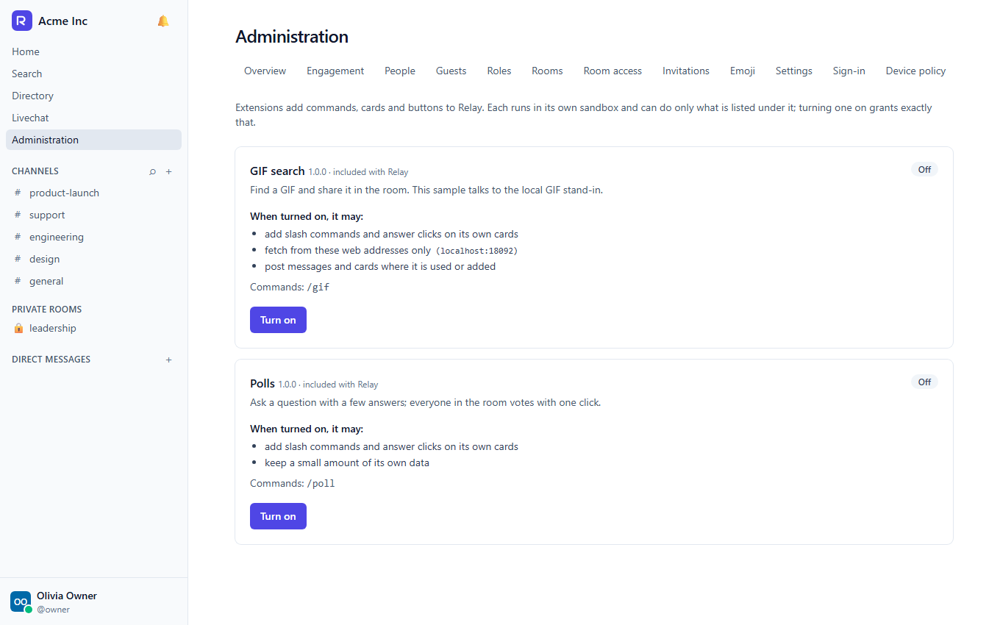

<div align="center">


# Relay documentation

Everything you need to use, run and extend Relay.<br />
These pages are part of the product and are updated with every release.

</div>

## Start here

<table>
<tr>
<td width="33%" valign="top">

### 💬 Use Relay

**[User guide](user-guide.md)**

Rooms, messages, threads, calls, notifications, search and keyboard shortcuts. Also for
livechat agents.

</td>
<td width="33%" valign="top">

### 🛠️ Run Relay

**[Admin guide](admin-guide.md)**

Install with Docker Compose or Kubernetes, settings, monitoring, backups, the admin console,
extensions and sizing.

</td>
<td width="33%" valign="top">

### 🔌 Build on Relay

**[API guide](api-guide.md)**

Access tokens, the REST API, bots, webhooks, slash commands and interactive cards.

</td>
</tr>
</table>

## Get Relay running in two minutes

You need Docker with Compose. Relay itself is pulled as an image; the `deploy` folder holds
the files that run it.

```sh
git clone https://github.com/Velarixx/relay-docs.git
cd relay-docs/deploy/compose
```

Copy `.env.example` to `.env`, set `RELAY_DOMAIN=localhost` for a trial, and fill in
`SECRET_KEY` and `POSTGRES_PASSWORD` with long random values. Then:

```sh
docker compose up -d
```

Open <https://localhost> and follow the setup wizard. Your browser warns once about the trial
certificate, because `localhost` cannot get a public one. For a real installation with your own
domain, continue with [Install](admin-guide.md#install) in the admin guide.

## All guides

### Using Relay

| Page                                              | What you will find                                               |
| ------------------------------------------------- | ---------------------------------------------------------------- |
| [User guide](user-guide.md)                       | Everyday use, from your first message to calls and livechat      |
| [Messages](user-guide.md#messages)                | Formatting, mentions, threads, files, scheduling and commands    |
| [Encryption](user-guide.md#end-to-end-encryption) | What end-to-end encrypted rooms protect, and what they cannot do |
| [Finding things](user-guide.md#finding-things)    | The quick switcher, search and keyboard shortcuts                |

### Running Relay

| Page                                                          | What you will find                                                             |
| ------------------------------------------------------------- | ------------------------------------------------------------------------------ |
| [Install](admin-guide.md#install)                             | Docker Compose with automatic HTTPS, and the Helm chart                        |
| [Settings](admin-guide.md#settings-from-the-environment)      | Every environment variable and what it does                                    |
| [Health and monitoring](admin-guide.md#health-and-monitoring) | Health checks, Prometheus metrics and the Grafana dashboard                    |
| [Backups](admin-guide.md#backups)                             | Backing up and restoring the database and files                                |
| [The admin console](admin-guide.md#the-admin-console)         | People, roles, rooms, sign-in, integrations and the audit log                  |
| [Extensions](admin-guide.md#extensions)                       | What extensions may do, the sandbox, and the catalogue                         |
| [Sizing](admin-guide.md#sizing)                               | Measured capacity and rules of thumb                                           |
| [Upgrade guide](upgrade-guide.md)                             | Upgrading, rolling upgrades on Kubernetes, and going back                      |
| [Importing data](import-format.md)                            | Bringing people and history in from CSV, Mattermost, Slack or the Relay format |

### Enterprise

| Page                                                                        | What you will find                                                     |
| --------------------------------------------------------------------------- | ---------------------------------------------------------------------- |
| [Licensing](licensing.md)                                                   | Subscriptions, activation keys, offline keys and what a licence covers |
| [Device policy](device-policy.md)                                           | Which devices may sign in, how many, and confirming new ones           |
| [Data-loss rules](data-loss-rules.md)                                       | Blocking or masking sensitive text in messages                         |
| [Compliance export](compliance-export.md)                                   | Exporting messages and files for legal and audit requests              |
| [AI assistant and translation](admin-guide.md#ai-assistant-and-translation) | Summaries, catch-up, reply suggestions and translation                 |

### Building on Relay

| Page                                       | What you will find                                                  |
| ------------------------------------------ | ------------------------------------------------------------------- |
| [API guide](api-guide.md)                  | Tokens, the REST API, bots, webhooks and commands                   |
| API reference                              | Every route and field, served by your own Relay at `/api/docs`      |
| [Writing an extension](extension-guide.md) | Starting one, the manifest, permissions, hooks and a worked example |

## A look at Relay

A channel in the middle of a working day, the roles and permissions an admin hands out, and
the page where an admin sees what each extension may do.

<div align="center">

<picture>
  <source media="(prefers-color-scheme: dark)" srcset="images/chat-dark.png" />
  
</picture>

<br /><br />



<br /><br />



</div>

## Help

- Something unclear or missing in these pages?
  [Open an issue](https://github.com/Velarixx/relay-docs/issues).

- Questions about your subscription? Use the link in your activation email to manage it, or
  see [licensing](licensing.md).
